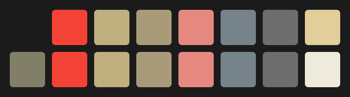
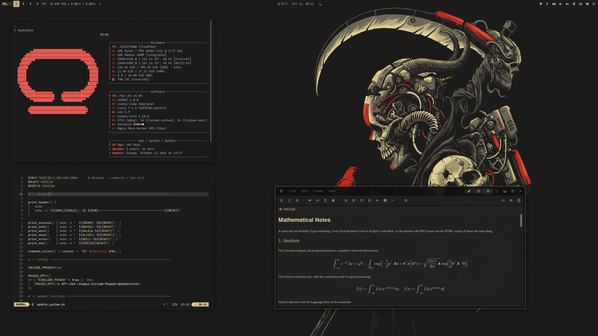
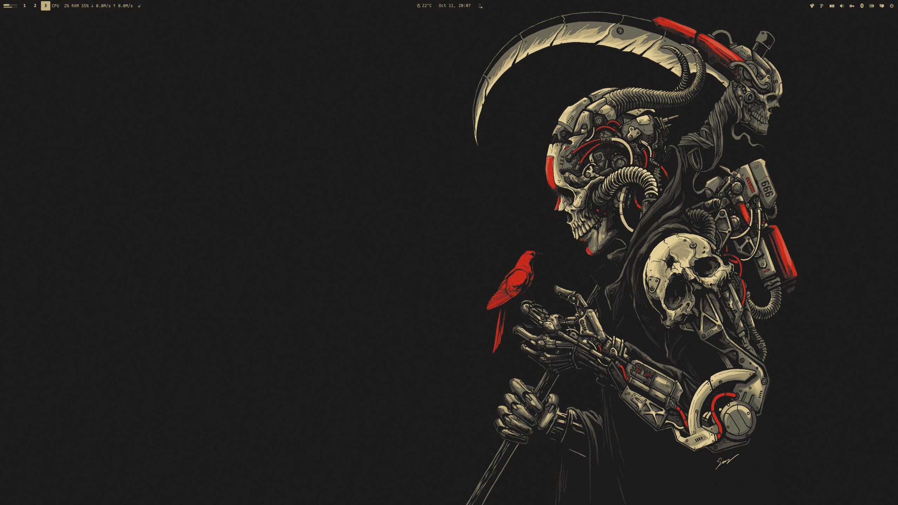

<div align="center">

# COSMIC · DarkGold



Pop!_OS 24.04 on COSMIC in Harbor Dark gold: desktop, terminal, shell, Firefox, Brave, cursor.
The dark half of a pair; the light sibling is
[cosmic-whitegold-theme](https://github.com/atraxsrc/cosmic-whitegold-theme).


[](https://atraxsrc.github.io/cosmic-rices/)


</div>

Firefox uses the [cosmic-darkgold-theme](https://addons.mozilla.org/en-US/firefox/addon/cosmic-darkgold-theme/) add-on.
Icons: [Cosmic-DarkGold](https://github.com/atraxsrc/cosmic-icon-themes), Kanagawa recolored to this palette.
Cursor: [Oxygen](https://github.com/wo2ni/Oxygen-Cursors) recoloured to the icon colours (Gold, Red, Dark), COSMIC-fixed.

---


## Palette

Harbor Dark.

| Role | Color | Hex |
|------|-------|-----|
| Background |  Charcoal |  `#1B1B1B` |
| Foreground |  Parchment |  `#efebdc` |
| Cream |  Bone |  `#E1CE98` |
| Gold |  Accent |  `#C0AF7F` |
| Brass |  Secondary |  `#a99b7a` |
| Salmon |  Cool accent |  `#e58980` |
| Coral |  Headers |  `#e75a50` |
| Error |  Red |  `#F44336` |
| Slate |  Muted metal |  `#77838a` |
| Dim |  Comments |  `#6d6d6d` |
| Olive |  Bright-black |  `#817f68` |

---

## Repo Structure

```
.
├── assets
│   ├── cosmic-term/             # scheme previews for cosmic-term/README.md
│   ├── cursors/                 # cursor swatch for cursors/README.md
│   ├── palette.png              # the 16 terminal colours, under the title
│   └── screenshot.png           # README screenshot
├── backgrounds/                 # wallpapers, darkgold-<subject>.png (see Wallpaper)
├── alacritty
│   ├── darkgold.toml            # Alacritty colour scheme
│   └── install.sh
├── bat
│   ├── DarkGold.tmTheme         # bat syntax theme (delta uses it too)
│   ├── config                   # --theme="DarkGold"
│   └── install.sh
├── brave
│   ├── theme                    # Chromium theme (manifest + icons), Load unpacked
│   └── README.md
├── btop
│   └── DarkGold.theme           # btop colour theme
├── claude-desktop
│   ├── cosmic-darkgold.jsonc    # Claude Desktop theme (claude-desktop-extra), dark + light
│   └── install.sh
├── cosmic
│   ├── DarkGold.ron             # COSMIC Appearance import (Dark)
│   ├── DarkGold-Light.ron       # COSMIC Appearance import (Light)
│   ├── *-fixed-text.ron         # same, text tint pinned to gold (see the bug below)
│   ├── config/                  # baseline settings: fonts, icons, terminal look
│   └── install.sh
├── cosmic-term
│   ├── DarkGold-term*.ron       # COSMIC Terminal schemes (Harbor Dark + variants)
│   ├── DarkGold-Light-term*.ron # COSMIC Terminal schemes (Harbor Light + variants)
│   └── README.md                # which scheme to pick, previews
├── cursors/                     # Oxygen-DarkGold-{Gold,Red,Dark}, COSMIC-fixed
│   ├── recolour.py              # makes a variant from any coloured Oxygen theme
│   ├── install.sh
│   ├── uninstall.sh
│   └── README.md
├── delta
│   ├── darkgold.gitconfig       # delta (git pager) colours, [include] it from ~/.gitconfig
│   └── install.sh
├── discord
│   ├── cosmic-darkgold.theme.css # Vencord / Vesktop theme, DarkGold (dark) + White Gold (light)
│   └── install.sh
├── ghostty
│   ├── DarkGold                 # Ghostty theme
│   └── install.sh
├── gtk
│   ├── darkgold.css             # GTK 3 / 4 named colours for non-COSMIC apps
│   └── install.sh
├── helix
│   ├── darkgold.toml            # Helix theme
│   └── install.sh
├── icons
│   └── install.sh               # Cosmic-DarkGold icon pack from cosmic-icon-themes
├── fastfetch
│   ├── config.jsonc             # Harbor Dark fastfetch config
│   ├── cosmic.txt               # COSMIC logo
│   └── install.sh
├── firefox
│   ├── theme                    # cosmic-darkgold-theme add-on source (manifest + icons)
│   ├── chrome
│   │   ├── userChrome.css
│   │   └── userContent.css
│   ├── install.sh
│   └── README.md
├── notesnook
│   └── cosmic-darkgold.json     # Notesnook theme, DarkGold (dark)
├── nvim                         # Neovim colorscheme, LazyVim spec, RON syntax, install.sh
├── obsidian
│   ├── cosmic-darkgold.css      # CSS snippet, DarkGold (dark) + White Gold (light)
│   └── install.sh
├── qt
│   ├── DarkGold.conf            # qt5ct / qt6ct colour scheme
│   └── install.sh
├── starship
│   ├── starship.toml            # prompt, palette colours
│   └── install.sh
├── telegram
│   ├── colors.tdesktop-theme    # Telegram Desktop colour scheme (source)
│   ├── cosmic-darkgold.tdesktop-theme  # built theme, open this in Telegram
│   └── build.sh                 # rebuilds it, optionally with a wallpaper
├── vscode
│   ├── themes/                  # Cursor / VS Code colour themes, DarkGold (dark) + White Gold (light)
│   ├── package.json             # extension manifest
│   ├── install.sh               # packs a .vsix, installs it with cursor --install-extension
│   └── README.md
├── scripts
│   ├── update_system.sh         # nala + flatpak, Harbor Dark ANSI
│   └── switch.sh                # make this the active rice (see Switching rice)
├── kitty
│   ├── DarkGold.conf            # kitty colour scheme
│   └── install.sh
├── lazygit
│   ├── darkgold.yml             # lazygit colours only, stacked on your config.yml
│   └── install.sh
├── lsd
│   ├── config.yaml              # theme: custom
│   ├── colors.yaml              # permission / size / date / git columns
│   └── install.sh
├── wezterm
│   ├── darkgold.lua             # WezTerm colours, config.colors = require("darkgold")
│   └── install.sh
├── zsh
│   ├── darkgold.zsh             # LS_COLORS, highlighting colours, aliases, starship, lazygit
│   └── install.sh
├── docs
│   ├── screenshot-baseline.md   # the one-scene screenshot recipe shared by all the rices
│   └── showcase.md              # the rice describing itself, for the Postilla pane of the screenshot
├── packages.txt                 # what a fresh install needs (apt + manual)
├── LICENSE
└── README.md
```

---

## COSMIC Desktop

Settings → Desktop → Appearance → **Dark** → **Import** → `cosmic/DarkGold.ron`

Accent is gold  `#C0AF7F`. Use the `+` control if you want a custom swatch.

Frosted glass is on in the `.ron` at `frosted: VeryLow` for windows, panel,
applets and system UI (maximized apps stay solid). Adjust it on Appearance →
Style → Frosted glass after import; those sliders survive a theme switch.

Export from Appearance if you tweak backgrounds / tints so you do not lose them.

**Known COSMIC bug:** moving the frosted glass opacity / thickness sliders can
reset `text_tint` to  `#FFFFFF`. If your text turns white, re-import
`cosmic/DarkGold-fixed-text.ron` (tint pinned to gold  `#C0AF7F`), or
`cosmic/DarkGold-Light-fixed-text.ron` in light mode, where white text on
parchment is unreadable (dark gold  `#655628`). Upstream fix proposed in
[libcosmic#1450](https://github.com/pop-os/libcosmic/pull/1450), not merged.

### Baseline settings

`cosmic/config/` holds the settings that make up the look and rarely change
(panel, dock, applets and shortcuts are left out on purpose):

| Where | Setting |
|-------|---------|
| Fonts | Interface `Maple Mono Normal`, monospace `Maple Mono Normal NFM` |
| Icons | Cosmic-DarkGold-Gold |
| Windows | Minimize / maximize buttons hidden, theme applied to GNOME apps |
| Terminal | Maple Mono 15 (weights 500 / bold 800 / dim 300), 77% opacity, no header bar, Harbor Dark / Harbor Light |

Install the [Maple fonts](https://github.com/subframe7536/maple-font/releases)
(Maple Mono Normal and Maple Mono Normal NFM) and the Cosmic-DarkGold icons (see
Icons below) and import the terminal schemes first, then:

```bash
./cosmic/install.sh
```

It backs up each file it replaces to `*.bak` and COSMIC applies it live.

---

## COSMIC Terminal

The desktop `.ron` does not colour ANSI text.

1. COSMIC Terminal → **View → Color schemes…** (not Settings → Appearance)
2. Dark tab → **Import** → `cosmic-term/DarkGold-term.ron`
3. View → Settings → Appearance → Color scheme (dark) → **Harbor Dark**

If a profile is set as default, set the scheme on that profile too or the
dropdown will look like it did nothing.

There are variants for both modes with gold or slate text (to pair with the
gold text tint, or match btop). Previews and which to pick:
[`cosmic-term/README.md`](cosmic-term/README.md).

Nala progress boxes use Rich `green`. In this scheme that slot is gold  `#C0AF7F`.

---

## Light mode

COSMIC keeps a separate theme for Dark and Light, so the light look needs its
own import. Import both once and the Dark / Light toggle (or auto-switch)
flips between them.

**Desktop:** Settings → Desktop → Appearance → **Light** → **Import** →
`cosmic/DarkGold-Light.ron`

**Terminal:** View → Color schemes… → **Light** tab → **Import** →
`cosmic-term/DarkGold-Light-term.ron`, then View → Settings → Appearance →
Color scheme (light) → **Harbor Light** (gold and slate variants in
[`cosmic-term/README.md`](cosmic-term/README.md)).

Same palette, flipped: a darker parchment window background with lighter
cards on top so panels stand out, charcoal text, and deeper shades of the
accents so they stay readable (all at least 4.5:1 contrast on the window
background).

| Role | Dark | Light |
|------|------|-------|
| Background |  `#1B1B1B` |  `#D9D1B8` |
| Containers |  `#2A2A29` /  `#3C3C39` |  `#EFEBDC` /  `#F8F6EE` |
| Text |  `#EFEBDC` |  `#1B1B1B` |
| Accent (gold) |  `#C0AF7F` |  `#655628` |
| Success (brass) |  `#A99B7A` |  `#5E5545` |
| Salmon |  `#E58980` |  `#89433C` |
| Coral |  `#E75A50` |  `#A23026` |
| Error |  `#F44336` |  `#B01A1A` |
| Slate |  `#77838A` |  `#4A545A` |

Spacing, corners, gaps and frosted glass match the dark theme.

For a full light rice (parchment palette, own wallpapers, terminal, btop,
nvim), see [cosmic-whitegold-theme](https://github.com/atraxsrc/cosmic-whitegold-theme).

The cosmic-darkgold-theme Firefox add-on and `firefox/chrome/` are dark only.
For a light Firefox, use White Gold's
[cosmic-whitegold-theme](https://addons.mozilla.org/en-US/firefox/addon/cosmic-whitegold-theme/).

Not covered yet: `update_system.sh` uses light text colours that are hard to
read on a light terminal.

---

## Firefox

Two layers:

1. **Theme (colours):** install
   **[cosmic-darkgold-theme on addons.mozilla.org](https://addons.mozilla.org/en-US/firefox/addon/cosmic-darkgold-theme/)**
   This is the main look.
2. **Stylesheets (optional):** `firefox/chrome/` adds rounded corners, gold
   menu hover, gold accents and blank new-tab tiles on top of the add-on
   (they also work with Firefox's built-in Dark theme):

```bash
chmod +x firefox/install.sh
./firefox/install.sh
```

Fully quit Firefox afterward. Details: [`firefox/README.md`](firefox/README.md).

---

## Brave

`brave/theme` is a Chromium theme with the Firefox theme's colours: near-black
frame, charcoal toolbar, gold icons and inactive tabs, coral on the active tab.
Brave, Chrome, Chromium and Edge take it, and it loads straight from the
clone, so no Chrome Web Store or Google account is needed:

`brave://extensions` → **Developer mode** → **Load unpacked** → `brave/theme`

Leave the clone in place, Brave keeps reading the folder. Colours, limits and
packing a `.crx`: [`brave/README.md`](brave/README.md).

---

## Claude Desktop

For the unofficial [claude-desktop-extra](https://github.com/patrickjaja/claude-desktop-extra)
Linux build. `claude-desktop/cosmic-darkgold.jsonc` is one theme with both halves:
DarkGold in dark mode and White Gold in light mode, so Claude's own
Settings → Appearance toggle switches between the two rices.
Colours come from `cosmic/*.ron`, contrast-checked (text and button text
4.5:1, accents 3:1).

```bash
./claude-desktop/install.sh
```

It copies the file into `~/.config/Claude/themes.d/`. Then press
<kbd>Ctrl</kbd>+<kbd>Shift</kbd>+<kbd>T</kbd> in Claude Desktop and pick **cosmic-darkgold**.

The same file ships in [`cosmic-whitegold-theme`](https://github.com/atraxsrc/cosmic-whitegold-theme),
so installing from either repo gives the same theme.

---

## Cursor editor

`vscode/` is a colour theme extension for [Cursor](https://cursor.com) with
both halves of the pair: **Cosmic DarkGold** and **Cosmic White Gold**. It is a plain
VS Code theme extension, so VS Code and VSCodium take it too, and the same
folder ships in cosmic-whitegold-theme. Code is coloured the way Neovim is in
each rice; the workbench takes the desktop's window and container colours,
with the accent on the active tab, buttons and menu highlight, and the
integrated terminal uses the COSMIC Terminal scheme. Cursor builds its Agent
and chat panels from the same theme colours, so they follow along.

```bash
./vscode/install.sh
```

It packs `vscode/` into a `.vsix` and installs it with
`cursor --install-extension`; run it again after editing the theme. Then press
<kbd>Ctrl</kbd>+<kbd>K</kbd> <kbd>Ctrl</kbd>+<kbd>T</kbd> in Cursor and pick
**Cosmic DarkGold**. Three lines in Cursor's `settings.json` make it follow
COSMIC's Dark / Light toggle between DarkGold and White Gold; they, the colours and
the contrast notes are in [`vscode/README.md`](vscode/README.md).

---

## Telegram

`telegram/cosmic-darkgold.tdesktop-theme` is a Telegram Desktop theme: steel
text (the Harbor Dark Steel shade, lifted to  `#A3AAAD` for 4.5:1 on hover and
bubble colours) on a charcoal chat list and background, dark-grey incoming and
warm-brown outgoing bubbles, gold for the accent, links, unread badges and
buttons (with charcoal text on them), brass for online status and read ticks.
Group member names use the rice's terminal colours. Text and badge colours are
contrast-checked at 4.5:1 or better, except disabled menu items.

Settings → Chat Settings → Chat wallpaper → **Choose from file** →
`telegram/cosmic-darkgold.tdesktop-theme` → **Apply this theme**.

The colours live in `telegram/colors.tdesktop-theme`, which is plain text;
`build.sh` zips it with the chat background into the `.tdesktop-theme`. The
background is the plain window colour; to put a wallpaper behind the chat instead
(ImageMagick re-encodes it to a 2560px JPEG, Telegram caps theme files at 5 MB):

```bash
./telegram/build.sh --wallpaper backgrounds/darkgold-anime.png
```

Built against Telegram Desktop 7.3.1. Calls, group calls, statistics charts and
premium badges keep Telegram's own colours.

Telegram has no dark / light pairing, so White Gold, the light half, ships its
own theme.

---

## Wallpaper

Wallpapers ship in [`backgrounds/`](backgrounds/), named `darkgold-<subject>.png`.
Four are the Harbor Dark originals (MIT), unchanged, since Harbor Dark is this
palette: the reaper (the one in the
screenshot), the Hyundai blueprint, the harbor in space and the space monolith. The
rest are renders in gold and coral on charcoal: the geisha, The Greek eagle, and three
new scenes, city, panel and tower.

Settings → Desktop → Wallpaper → **Add image** → pick a file from `backgrounds/`.



---

## Icons

**Cosmic-DarkGold**, the [Kanagawa icons](https://github.com/Fausto-Korpsvart/Kanagawa-GKT-Theme/tree/main/icons/Kanagawa)
by Fausto Korpsvart recolored to this palette in
[cosmic-icon-themes](https://github.com/atraxsrc/cosmic-icon-themes). Folders come in
three colors: **Gold**  `#C0AF7F` (default), **Red**  `#E75A50` and **Dark**  `#2A2A29` with gold symbols.


```bash
./icons/install.sh                  # Gold folders
./icons/install.sh --variant Red    # or Dark
```

It downloads the pack from the latest cosmic-icon-themes release, checks its SHA256,
installs it to `~/.local/share/icons/` and sets it as the COSMIC icon theme.
Restart open apps afterwards (Files caches icons per window).
Add `--system` to install to `/usr/share/icons` instead, for every user and the
login screen (asks for sudo); `--user` is the default.

---

## GTK and Qt apps

COSMIC colours GTK apps itself when Appearance → **Apply theme to GNOME apps**
is on (the baseline config turns it on). `gtk/darkgold.css` is the same palette
pinned by hand for GTK 3 and GTK 4 / libadwaita apps: windows and lists on
 `#1B1B1B`, cards, popovers and dialogs on  `#2A2A29`, text in  `#EFEBDC`, selection
and accent in  `#C0AF7F` with  `#1B1B1B` text on it,  `#A99B7A` for
success and  `#C0AF7F` for warnings. It only sets the named colours, so
widgets keep their stock shapes, and it also works where COSMIC's toggle does
not reach (another desktop, Flatpak apps given access to `~/.config/gtk-4.0`).

```bash
./gtk/install.sh
```

It copies the file to `~/.config/gtk-3.0/` and `~/.config/gtk-4.0/` and adds
`@import url("darkgold.css");` to `gtk.css` there, after COSMIC's own import so
these colours win (backup in `gtk.css.bak`); another rice's import is
commented out. Restart GTK apps.

`qt/DarkGold.conf` is a colour scheme for [qt5ct](https://github.com/desktop-app/qt5ct)
/ [qt6ct](https://github.com/trialuser02/qt6ct): windows on  `#1B1B1B`, text
fields and lists on  `#1B1B1B`, buttons and tooltips on  `#2A2A29`, text in
 `#EFEBDC`,  `#C0AF7F` for the highlight and links, placeholders in  `#6D6D6D`,
disabled text in  `#6D6D6D`.

```bash
./qt/install.sh
# qt6ct → Appearance → Color scheme → DarkGold, Palette: Custom → Apply
```

Qt apps read it with `QT_QPA_PLATFORMTHEME=qt6ct` (or `qt5ct`) in the
environment; `~/.config/environment.d/` or your `~/.zshrc` is the place.

Text and secondary text read at 4.5:1 or better on the window, container and
field colours; disabled, placeholder and dim text, like comments elsewhere in
the rice, at 2.8:1.

---

## Obsidian

`obsidian/cosmic-darkgold.css` is a CSS snippet with both halves of the pair:
DarkGold in dark mode, White Gold in light mode, so with Settings →
Appearance → Base color scheme → **Adapt to system** Obsidian follows COSMIC's
Dark / Light toggle. Editor on  `#1B1B1B`, sidebars on  `#2A2A29`, text in  `#EFEBDC`,
links and accent in  `#C0AF7F`, headings coloured like Neovim's
( `#C0AF7F` /  `#C0AF7F` /  `#77838A`), code and checkboxes in  `#A99B7A`, tags
in  `#C0AF7F`. The same file ships in cosmic-whitegold-theme.

```bash
./obsidian/install.sh ~/path/to/vault
# Settings → Appearance → CSS snippets → cosmic-darkgold
```

It copies the file into the vault's `.obsidian/snippets/`. Snippets are per
vault, so run it once per vault.

---

## Notesnook

`notesnook/cosmic-darkgold.json` is a [Notesnook](https://notesnook.com/) theme for DarkGold,
built from the same palette as the Obsidian snippet: window, list and sidebar
backgrounds, text, accent, selection and the error / success colours. A
Notesnook theme holds one colour scheme, so the White Gold half ships as
`notesnook/cosmic-whitegold.json` in cosmic-whitegold-theme; load both if you switch between
dark and light.

```text
Notesnook → Settings → Appearance → Themes → Load from file
→ pick notesnook/cosmic-darkgold.json → Set as default
```

---

## Discord

`discord/cosmic-darkgold.theme.css` is a theme for [Vencord](https://vencord.dev/)
and [Vesktop](https://github.com/Vencord/Vesktop), colours only: chat on
 `#1B1B1B`, sidebars and inputs on  `#2A2A29`, server list on  `#1B1B1B`, text in
 `#EFEBDC`, channel names in  `#A8A59B`, accent, mentions and links in
 `#C0AF7F`,  `#A99B7A` for online and positive,  `#C0AF7F` for
warnings. The light half is White Gold and the dark half DarkGold, so
with Appearance → Theme → **Sync with computer** it follows COSMIC's toggle.
The same file ships in cosmic-whitegold-theme.

```bash
./discord/install.sh
# Settings → Vencord → Themes → Load missing themes → Cosmic Darkgold
```

It copies the file into every Vencord and Vesktop config folder it finds:
`~/.config/Vencord/themes/`, `~/.config/vesktop/themes/`, and for the Flatpak
builds `~/.var/app/com.discordapp.Discord/config/Vencord/themes/` and
`~/.var/app/dev.vencord.Vesktop/config/vesktop/themes/`. Discord renames its CSS
variables now and then; the file sets both the long-standing names and the
2025 visual-refresh names. Text on the surfaces is 4.5:1 or better; the text on
Discord's own accent-coloured buttons stays its white, at 2.2:1.

---

## Cursor

**Oxygen** cursors recoloured to the icon colours, one per folder colour of the
Cosmic-DarkGold icon pack: **Gold** (default), **Red**, **Dark**. Patched with the cursor
names COSMIC apps ask for. COSMIC has no cursor picker yet, so the script sets it:

```bash
./cursors/install.sh                      # Gold
./cursors/install.sh --variant Red       # or another, see --list
reboot
```

Previews, what the script touches, how to undo it and how the colours are made:
[`cursors/README.md`](cursors/README.md).

---

## Terminal extras

Both need a [Nerd Font](https://www.nerdfonts.com/) in the terminal for the icons
(the screenshot uses Maple Mono NFM).

### fastfetch

`fastfetch/` holds a Harbor Dark config with a COSMIC logo in coral and
Hardware / Software / Age boxes. `install.sh` backs up any existing
`~/.config/fastfetch/config.jsonc` to `config.jsonc.bak` before copying.

```bash
./fastfetch/install.sh
fastfetch
```

### kitty, Alacritty, WezTerm, Ghostty

The COSMIC Terminal scheme for other terminals, one file each with the same
sixteen ANSI colours, text in  `#EFEBDC`, the cursor in  `#EFEBDC` and the
selection on  `#4E4E49`. Each installer copies the file next to that terminal's
config and backs up what it replaces; the one include line you add is
printed, and is in the comment at the top of each file:

```bash
./kitty/install.sh        # ~/.config/kitty/themes/DarkGold.conf       kitty.conf:     include themes/DarkGold.conf
./alacritty/install.sh    # ~/.config/alacritty/themes/darkgold.toml   alacritty.toml: [general] import = ["~/.config/alacritty/themes/darkgold.toml"]
./wezterm/install.sh      # ~/.config/wezterm/darkgold.lua             wezterm.lua:    config.colors = require("darkgold")
./ghostty/install.sh      # ~/.config/ghostty/themes/DarkGold          config:         theme = DarkGold
```

Ghostty and WezTerm can follow COSMIC's Dark / Light toggle once the White Gold
half is installed from its repo as well: `theme = dark:DarkGold,light:WhiteGold` in
Ghostty, and in WezTerm

```lua
local dark = (wezterm.gui and wezterm.gui.get_appearance() or "Dark"):find("Dark")
config.colors = require(dark and "darkgold" or "whitegold")
```

kitty and Alacritty have no such switch; include the other file instead.

### starship

`starship/starship.toml` is close to the defaults with the palette declared
once as `[palettes.darkgold]` and used by name: the directory in  `#A8A59B`,
the branch in  `#A99B7A`,  `#C0AF7F` for a dirty tree, a  `#A99B7A` prompt
character that turns  `#F44336` after a failed command. Modules it does not style keep their defaults, which use the ANSI
slots the COSMIC Terminal scheme colours. `zsh/darkgold.zsh` already runs
`starship init`. `install.sh` backs up any existing `~/.config/starship.toml`
to `starship.toml.bak`.

```bash
./starship/install.sh
```

### bat

`bat/DarkGold.tmTheme` is a syntax theme coloured the way Neovim is in this
rice: keywords in  `#E75A50`, strings in  `#A99B7A`, functions in  `#C0AF7F`, numbers
in  `#E58980`, types in  `#77838A`, imports and escapes in  `#E1CE98`, italic
comments in  `#6D6D6D`, on the editor background  `#1B1B1B`. `zsh/darkgold.zsh`
aliases `cat` to bat. `install.sh` copies the theme to `~/.config/bat/themes/`,
rebuilds bat's cache so bat and delta can find it, and sets `--theme="DarkGold"`
in `~/.config/bat/config` (backup in `config.bak`).

```bash
./bat/install.sh
batcat README.md
```

### delta

`delta/darkgold.gitconfig` colours [delta](https://github.com/dandavison/delta),
the git diff pager: removed lines in  `#F44336` and added lines in
 `#A99B7A` on the container  `#2A2A29`, changed words on a solid block of
those two colours with  `#1B1B1B` text, the same as Neovim's diff highlights;
file names in  `#C0AF7F`, commit hashes in  `#A99B7A`, hunk headers in
 `#A8A59B` inside  `#817F68` boxes, line numbers. Code inside the diff
uses the bat theme above, so install that first. `install.sh` copies the file
to `~/.config/delta/` and prints the `[include]` to add to `~/.gitconfig`; it
never edits that file.

```bash
./delta/install.sh
```

```ini
# ~/.gitconfig
[include]
    path = ~/.config/delta/darkgold.gitconfig
[core]
    pager = delta
[interactive]
    diffFilter = delta --color-only
```

### lazygit

`lazygit/darkgold.yml` holds only the `gui.theme` block: active border in
 `#C0AF7F`, inactive borders in  `#817F68`, the selected line on  `#3C3C39`,
 `#A99B7A` and  `#A99B7A` marks for cherry-picked and base commits,
unstaged changes in  `#F44336`, author names in  `#A99B7A`. lazygit reads one
config file, so instead of replacing your `~/.config/lazygit/config.yml` the
installer drops the theme beside it and `zsh/darkgold.zsh` sets `LG_CONFIG_FILE`
to both, your file first, so the colours win and your keybindings stay.

```bash
./lazygit/install.sh
exec zsh
```

Without the zsh layer, export it yourself:
`LG_CONFIG_FILE="$HOME/.config/lazygit/config.yml,$HOME/.config/lazygit/darkgold.yml"`.

### Helix

`helix/darkgold.toml` is the Neovim colorscheme for [Helix](https://helix-editor.com/):
same syntax roles, editor on  `#1B1B1B`, status line and popups on  `#2A2A29`,
cursor and current line number in  `#C0AF7F`, the mode shown as a solid
 `#C0AF7F` /  `#A99B7A` /  `#A99B7A` block. `install.sh` copies it to
`~/.config/helix/themes/`.

```bash
./helix/install.sh
# ~/.config/helix/config.toml:  theme = "darkgold"
```

### zsh

`zsh/darkgold.zsh` is the rice part of the shell only: `LS_COLORS` (also used
by lsd for file names and by the completion menu), DarkGold colours for
zsh-autosuggestions and zsh-syntax-highlighting, the lsd / bat / nvim aliases,
the lazygit theme file and the starship prompt. Your own `~/.zshrc` stays private and sources it, so
PATH tweaks, display scaling and anything personal never land in this repo.

Needs zsh + [oh-my-zsh](https://ohmyz.sh/). `install.sh` clones the two
plugins if missing and appends one `source` line to `~/.zshrc` (backup in
`~/.zshrc.bak`):

```bash
./zsh/install.sh
exec zsh
```

In `~/.zshrc` keep `ZSH_THEME=""` and
`plugins=(git sudo zsh-autosuggestions zsh-syntax-highlighting)`.

### lsd

Two layers: file names are coloured by `LS_COLORS` from `zsh/darkgold.zsh`,
and `lsd/colors.yaml` colours the other columns (permissions, user, size,
date, git status) with the nearest 256-colour matches to the palette
(187 cream, 144 brass, 173 salmon, 167 coral, 102 slate). lsd 1.0.0 (Pop
24.04) does not accept `#hex` here: one hex value makes it silently drop the
whole theme. `install.sh` backs up existing files to `*.bak`.

```bash
./lsd/install.sh
lsd -l
```

### Neovim

`nvim/` carries the rice into Neovim: a dependency-free colorscheme built from
the palette (`nvim/colors/darkgold.lua`), a LazyVim spec that selects it and makes
sure the treesitter parsers for the files in this repo are installed
(`nvim/lua/plugins/darkgold.lua`), and a small RON syntax file so `cosmic/*.ron`
is coloured even before the parser exists. `:terminal` inside Neovim uses the
Harbor Dark scheme.

```bash
./nvim/install.sh
# restart nvim; LazyVim switches to the darkgold colorscheme
```

Without LazyVim, copy `nvim/colors/darkgold.lua` to `~/.config/nvim/colors/` and
run `:colorscheme darkgold`.

### btop

`btop/DarkGold.theme` uses the same palette: charcoal background, coral highlights, brass titles.

```bash
mkdir -p ~/.config/btop/themes
cp btop/DarkGold.theme ~/.config/btop/themes/
# btop → Esc → Options → Color theme → DarkGold
```

---

## Scripts

### `update_system.sh`

nala + flatpak updater. Headers are coral, success is cream,
the figlet ramp is olive → gold → cream.

```bash
chmod +x scripts/update_system.sh
./scripts/update_system.sh
```

### `switch.sh`

Makes this the active rice, coming from any other `cosmic-*-theme` rice. See
[Switching rice](#switching-rice).

```bash
./scripts/switch.sh
```

---

## Git safety net

The gitleaks pre-commit hook that used to live here grew into its own repo,
**[git-safety-net](https://github.com/atraxsrc/git-safety-net)**: the hook,
`scan.sh` for any repo's history, `status.sh` (am I protected?), a cheat sheet
and a walkthrough. Install it from there; this repo's `.pre-commit-config.yaml`
runs gitleaks on its own commits either way.

---

## Setup

```bash
git clone https://github.com/atraxsrc/cosmic-darkgold-theme.git
cd cosmic-darkgold-theme

# packages (apt list + manual installs, see the top of packages.txt)
sudo add-apt-repository ppa:zhangsongcui3371/fastfetch
grep -v '^#' packages.txt | xargs sudo apt install -y
chsh -s "$(command -v zsh)"

# desktop
# Settings → Appearance → Dark → Import cosmic/DarkGold.ron

# terminal
# View → Color schemes → Import cosmic-term/DarkGold-term.ron

# light mode (optional)
# Appearance → Light → Import cosmic/DarkGold-Light.ron
# Terminal → Color schemes → Light → Import cosmic-term/DarkGold-Light-term.ron

# firefox add-on
# https://addons.mozilla.org/en-US/firefox/addon/cosmic-darkgold-theme/

# optional extra chrome
# ./firefox/install.sh

# brave: brave://extensions → Developer mode → Load unpacked → brave/theme

# claude desktop (claude-desktop-extra), then Ctrl+Shift+T
./claude-desktop/install.sh

# cursor editor, then Ctrl+K Ctrl+T → Cosmic DarkGold
./vscode/install.sh

# telegram desktop
# Settings → Chat Settings → Chat wallpaper → Choose from file → telegram/cosmic-darkgold.tdesktop-theme

# shell + terminal tools (see Terminal extras above)
./zsh/install.sh
./lsd/install.sh
./fastfetch/install.sh
./nvim/install.sh
mkdir -p ~/.config/btop/themes && cp btop/DarkGold.theme ~/.config/btop/themes/

./starship/install.sh
./bat/install.sh
./delta/install.sh          # then the [include] it prints, in ~/.gitconfig
./lazygit/install.sh
./helix/install.sh          # then theme = "darkgold" in helix/config.toml

# other terminals, one include line each (see Terminal extras above)
./kitty/install.sh
./alacritty/install.sh
./wezterm/install.sh
./ghostty/install.sh

# gtk + qt apps (see GTK and Qt apps above)
./gtk/install.sh
./qt/install.sh             # then qt6ct → Color scheme → DarkGold

# obsidian + discord, both halves in one file (see above)
./obsidian/install.sh ~/path/to/vault
./discord/install.sh

# wallpaper
# Settings → Wallpaper → Add image → a file from backgrounds/ (see Wallpaper above)

# icons (Cosmic-DarkGold, see Icons above)
./icons/install.sh

# fonts (https://github.com/subframe7536/maple-font), then
# fonts, icons, terminal look from cosmic/config/
./cosmic/install.sh

# cursor (then reboot), see cursors/README.md
./cursors/install.sh                      # Gold
./cursors/install.sh --variant Red       # or another, see --list
reboot

# secret scan on every commit, every repo: https://github.com/atraxsrc/git-safety-net
```

---

## Switching rice

The installers replace what they own (with a `*.bak` copy), but some things
pile up instead: shell layers in `~/.zshrc`, LazyVim specs, the updater link and
btop's theme setting. `scripts/switch.sh` makes DarkGold the active rice, coming
from any other `cosmic-*-theme` rice, and tidies those up. Every rice repo ships
the same script.

```bash
./scripts/switch.sh               # switch, icons included
./scripts/switch.sh --keep-icons  # leave the current icon theme alone
```

It backs up every file it replaces, then:

- copies `cosmic/config/` (fonts, terminal look, icons) and turns dark mode on.
  The terminal scheme and icon theme are only replaced when the current one is
  not already a DarkGold variant, so a dimmer text variant or another icon colour
  survives. Icons stay as they are until `./icons/install.sh` has run.
- runs the fastfetch, lsd, bat, starship, delta, lazygit, kitty, Alacritty,
  WezTerm, Ghostty, Helix, GTK, Qt, Discord, Neovim and Claude Desktop
  installers and sets btop's `color_theme`. The terminal, editor and Qt
  installers only copy theme files; the include line you added once stays,
  switch it by hand when the file name differs between rices
- moves every other rice's LazyVim spec from `~/.config/nvim/lua/plugins/` to
  `~/.config/nvim/rice-off/` (LazyVim loads every spec there and the last
  colorscheme wins); your own specs stay
- comments out every other rice's `source` line in `~/.zshrc`, and
  cosmic-ricing's `ricing/zsh/colors.zsh`, then uncomments DarkGold's or adds it
- points `~/update_system.sh` at this repo's updater
- installs the Firefox userChrome / userContent

The GUI steps it cannot do are printed at the end:

1. Settings → Desktop → Appearance → Dark → Import `cosmic/DarkGold.ron`
2. COSMIC Terminal → View → Color schemes → Dark tab → Import `cosmic-term/DarkGold-term.ron`
3. Firefox: disable the old rice's add-on, enable [this one](https://addons.mozilla.org/en-US/firefox/addon/cosmic-darkgold-theme/), restart Firefox
4. Settings → Wallpaper → a file from `backgrounds/`
5. Claude Desktop: Ctrl+Shift+T → `cosmic-darkgold`, Appearance → Dark
6. `exec zsh`, restart Neovim (`:Lazy clean` drops plugins only the old specs used)
7. Obsidian: `./obsidian/install.sh <vault>`; delta: the `[include]` path in `~/.gitconfig`

Skip 1 and 2 when that slot already holds DarkGold. The first time on this rice,
run [Setup](#setup) once for the fonts, icons and cursor.

**Within the pair** (DarkGold ↔ [White Gold](https://github.com/atraxsrc/cosmic-whitegold-theme)): the two halves
sit side by side in COSMIC's Dark and Light slots and share one Claude Desktop
theme, so after the first time only the Firefox add-on and the wallpaper are
left by hand. Add `--keep-icons` to keep one icon colour across the pair.

Leaving DarkGold is the next rice's `./scripts/switch.sh`. `./cursors/uninstall.sh`
puts the Pop cursor back.

---

## Undo

1. Appearance → Dark → pick or import another theme
2. Terminal → View → Settings → Appearance → Color scheme (dark) → another scheme
3. Disable the [cosmic-darkgold-theme](https://addons.mozilla.org/en-US/firefox/addon/cosmic-darkgold-theme/) add-on
4. Cursor: `./cursors/uninstall.sh` (back to the Pop default), then reboot
5. Config files: each installer left a `*.bak` next to what it replaced

---

## Stack

| Tool | What it does |
|------|-------------|
| [Pop!_OS 24.04](https://pop.system76.com/) | Base OS by System76 |
| [COSMIC DE](https://system76.com/cosmic) | Desktop environment |
| [cosmic-darkgold-theme](https://addons.mozilla.org/en-US/firefox/addon/cosmic-darkgold-theme/) | Firefox theme |
| [fastfetch](https://github.com/fastfetch-cli/fastfetch) | System info |
| [btop](https://github.com/aristocratos/btop) | Resource monitor |
| [starship](https://starship.rs/) | Prompt |
| [bat](https://github.com/sharkdp/bat) | `cat` with syntax highlighting |
| [delta](https://github.com/dandavison/delta) | git diff pager |
| [lazygit](https://github.com/jesseduffield/lazygit) | git TUI |
| [Helix](https://helix-editor.com/) | Editor |
| [kitty](https://sw.kovidgoyal.net/kitty/), [Alacritty](https://alacritty.org/), [WezTerm](https://wezterm.org/), [Ghostty](https://ghostty.org/) | Other terminals |
| [qt6ct](https://github.com/trialuser02/qt6ct) | Qt colour scheme |
| [Vencord](https://vencord.dev/) / [Vesktop](https://github.com/Vencord/Vesktop) | Discord theme host |
| [oh-my-zsh](https://ohmyz.sh/) | zsh framework + plugins |
| [lsd](https://github.com/lsd-rs/lsd) | `ls` with icons and colours |
| [cosmic-icon-themes](https://github.com/atraxsrc/cosmic-icon-themes) | Icon pack (Cosmic-DarkGold), recolored from [Kanagawa icons](https://github.com/Fausto-Korpsvart/Kanagawa-GKT-Theme/tree/main/icons/Kanagawa) |
| [gitleaks](https://github.com/gitleaks/gitleaks) | Secret scan on every commit |
| [Oxygen-Cursors](https://github.com/wo2ni/Oxygen-Cursors) | Cursor theme (KDE Oxygen designs), recoloured to the icon colours, COSMIC-fixed |

## License

MIT. The cursor artwork keeps the terms of KDE's Oxygen project, see
[`cursors/README.md`](cursors/README.md).
