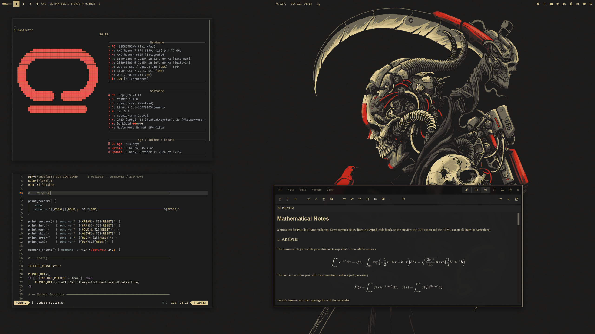
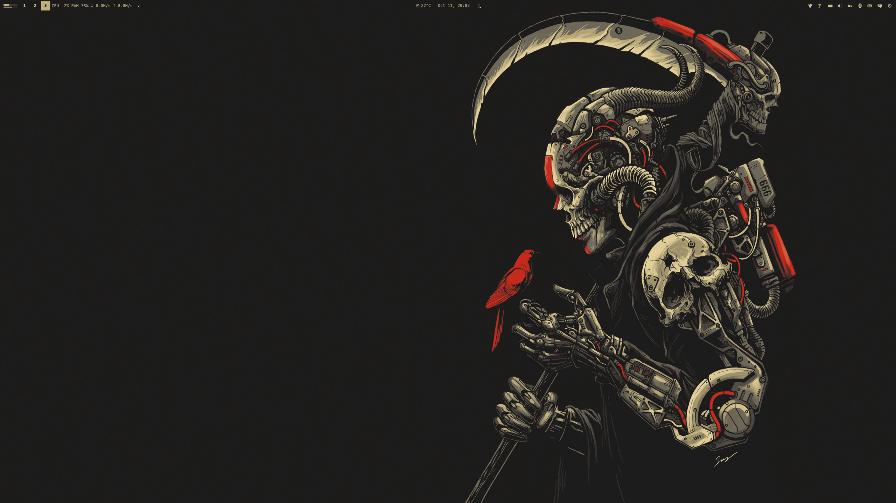

<div align="center">

# COSMIC · DarkGold

Pop!_OS 24.04 on COSMIC in Harbor Dark gold: desktop, terminal, shell, Firefox, cursor.
The dark half of a pair; the light sibling is
[cosmic-whitegold-theme](https://github.com/atraxsrc/cosmic-whitegold-theme).

Inspired by [omarchy-harbordark-theme](https://github.com/HANCORE-linux/omarchy-harbordark-theme).


</div>

Firefox uses the [cosmic-darkgold-theme](https://addons.mozilla.org/en-US/firefox/addon/cosmic-darkgold-theme/) add-on.
Icons: [Cosmic-DarkGold](https://github.com/atraxsrc/cosmic-icon-themes), Kanagawa recolored to this palette.
Cursor: [Oxygen](https://github.com/wo2ni/Oxygen-Cursors) Vibrant Red, COSMIC-fixed.

---


## Palette

Harbor Dark.

| Role | Color | Hex |
|------|-------|-----|
| Background |  Charcoal | `#1B1B1B` |
| Foreground |  Parchment | `#efebdc` |
| Cream |  Bone | `#E1CE98` |
| Gold |  Accent | `#C0AF7F` |
| Brass |  Secondary | `#a99b7a` |
| Salmon |  Cool accent | `#e58980` |
| Coral |  Headers | `#e75a50` |
| Error |  Red | `#F44336` |
| Slate |  Muted metal | `#77838a` |
| Dim |  Comments | `#6d6d6d` |
| Olive |  Bright-black | `#817f68` |

---

## Repo Structure

```
.
├── assets
│   ├── cosmic-term/             # scheme previews for cosmic-term/README.md
│   ├── cursors/                 # cursor swatch for cursors/README.md
│   └── screenshot.png           # README screenshot
├── backgrounds/                 # wallpapers, darkgold-<subject>.png (see Wallpaper)
├── bat
│   ├── config                   # --theme="ansi"
│   └── install.sh
├── btop
│   └── DarkGold.theme           # btop colour theme
├── cosmic
│   ├── DarkGold.ron             # COSMIC Appearance import (Dark)
│   ├── DarkGold-Light.ron       # COSMIC Appearance import (Light)
│   ├── *-fixed-text.ron         # same, text tint pinned to gold (see the bug below)
│   ├── config/                  # baseline settings: fonts, icons, terminal look
│   └── install.sh
├── cosmic-term
│   ├── DarkGold-term*.ron       # COSMIC Terminal schemes (Harbor Dark + variants)
│   ├── DarkGold-Light-term*.ron # COSMIC Terminal schemes (Harbor Light + variants)
│   └── README.md                # which scheme to pick, previews
├── cursors/                     # Oxygen-05-Vibrant-Red, COSMIC-fixed
│   ├── install.sh
│   ├── uninstall.sh
│   └── README.md
├── icons
│   └── install.sh               # Cosmic-DarkGold icon pack from cosmic-icon-themes
├── git-hooks
│   ├── pre-commit               # global gitleaks hook for every repo
│   ├── check-github.sh          # GitHub secret scanning / push protection report
│   └── install.sh
├── fastfetch
│   ├── config.jsonc             # Harbor Dark fastfetch config
│   ├── cosmic.txt               # COSMIC logo
│   └── install.sh
├── firefox
│   ├── chrome
│   │   ├── userChrome.css
│   │   └── userContent.css
│   ├── install.sh
│   └── README.md
├── nvim                         # Neovim colorscheme, LazyVim spec, RON syntax, install.sh
├── scripts
│   └── update_system.sh         # nala + flatpak, Harbor Dark ANSI
├── lsd
│   ├── config.yaml              # theme: custom
│   ├── colors.yaml              # permission / size / date / git columns
│   └── install.sh
├── starship
│   ├── starship.toml            # prompt, clock on the right
│   └── install.sh
├── zsh
│   ├── darkgold.zsh             # LS_COLORS, highlighting colours, aliases, starship
│   └── install.sh
├── docs
│   ├── screenshot-baseline.md   # the one-scene screenshot recipe shared by all the rices
│   └── showcase.md              # the rice describing itself, for the Postilla pane of the screenshot
├── packages.txt                 # what a fresh install needs (apt + manual)
├── LICENSE
└── README.md
```

---

## COSMIC Desktop

Settings → Desktop → Appearance → **Dark** → **Import** → `cosmic/DarkGold.ron`

Accent is gold `#C0AF7F`. Use the `+` control if you want a custom swatch.

Frosted glass is on in the `.ron` at `frosted: VeryLow` for windows, panel,
applets and system UI (maximized apps stay solid). Adjust it on Appearance →
Style → Frosted glass after import; those sliders survive a theme switch.

Export from Appearance if you tweak backgrounds / tints so you do not lose them.

**Known COSMIC bug:** moving the frosted glass opacity / thickness sliders can
reset `text_tint` to `#FFFFFF`. If your text turns white, re-import
`cosmic/DarkGold-fixed-text.ron` (tint pinned to gold `#C0AF7F`), or
`cosmic/DarkGold-Light-fixed-text.ron` in light mode, where white text on
parchment is unreadable (dark gold `#655628`). Upstream fix proposed in
[libcosmic#1450](https://github.com/pop-os/libcosmic/pull/1450), not merged.

### Baseline settings

`cosmic/config/` holds the settings that make up the look and rarely change
(panel, dock, applets and shortcuts are left out on purpose):

| Where | Setting |
|-------|---------|
| Fonts | Interface `Maple Normal UI`, monospace `Maple Mono Normal NFM` |
| Icons | Cosmic-DarkGold-Gold |
| Windows | Minimize / maximize buttons hidden, theme applied to GNOME apps |
| Terminal | Maple Mono 15 (weights 500 / bold 800 / dim 300), 77% opacity, no header bar, Harbor Dark / Harbor Light |

Install the [Maple fonts](https://github.com/subframe7536/maple-font) and the
Cosmic-DarkGold icons (see Icons below) and import the terminal schemes first, then:

```bash
./cosmic/install.sh
```

It backs up each file it replaces to `*.bak` and COSMIC applies it live.

---

## COSMIC Terminal

The desktop `.ron` does not colour ANSI text.

1. COSMIC Terminal → **View → Color schemes…** (not Settings → Appearance)
2. Dark tab → **Import** → `cosmic-term/DarkGold-term.ron`
3. View → Settings → Appearance → Color scheme (dark) → **Harbor Dark**

If a profile is set as default, set the scheme on that profile too or the
dropdown will look like it did nothing.

There are variants for both modes with gold or slate text (to pair with the
gold text tint, or match btop). Previews and which to pick:
[`cosmic-term/README.md`](cosmic-term/README.md).

Nala progress boxes use Rich `green`. In this scheme that slot is gold `#C0AF7F`.

---

## Light mode

COSMIC keeps a separate theme for Dark and Light, so the light look needs its
own import. Import both once and the Dark / Light toggle (or auto-switch)
flips between them.

**Desktop:** Settings → Desktop → Appearance → **Light** → **Import** →
`cosmic/DarkGold-Light.ron`

**Terminal:** View → Color schemes… → **Light** tab → **Import** →
`cosmic-term/DarkGold-Light-term.ron`, then View → Settings → Appearance →
Color scheme (light) → **Harbor Light** (gold and slate variants in
[`cosmic-term/README.md`](cosmic-term/README.md)).

Same palette, flipped: a darker parchment window background with lighter
cards on top so panels stand out, charcoal text, and deeper shades of the
accents so they stay readable (all at least 4.5:1 contrast on the window
background).

| Role | Dark | Light |
|------|------|-------|
| Background | `#1B1B1B` | `#D9D1B8` |
| Containers | `#2A2A29` / `#3C3C39` | `#EFEBDC` / `#F8F6EE` |
| Text | `#EFEBDC` | `#1B1B1B` |
| Accent (gold) | `#C0AF7F` | `#655628` |
| Success (brass) | `#A99B7A` | `#5E5545` |
| Salmon | `#E58980` | `#89433C` |
| Coral | `#E75A50` | `#A23026` |
| Error | `#F44336` | `#B01A1A` |
| Slate | `#77838A` | `#4A545A` |

Spacing, corners, gaps and frosted glass match the dark theme.

For a full light rice (parchment palette, own wallpapers, terminal, btop,
nvim), see [cosmic-whitegold-theme](https://github.com/atraxsrc/cosmic-whitegold-theme).

The cosmic-darkgold-theme Firefox add-on and `firefox/chrome/` are dark only.
For a light Firefox, use White Gold's
[cosmic-whitegold-theme](https://addons.mozilla.org/en-US/firefox/addon/cosmic-whitegold-theme/).

Not covered yet: `update_system.sh` uses light text colours that are hard to
read on a light terminal.

---

## Firefox

Two layers:

1. **Theme (colours):** install
   **[cosmic-darkgold-theme on addons.mozilla.org](https://addons.mozilla.org/en-US/firefox/addon/cosmic-darkgold-theme/)**
   (formerly harbordark). This is the main look.
2. **Stylesheets (optional):** `firefox/chrome/` adds rounded corners, gold
   menu hover, gold accents and blank new-tab tiles on top of the add-on
   (they also work with Firefox's built-in Dark theme):

```bash
chmod +x firefox/install.sh
./firefox/install.sh
```

Fully quit Firefox afterward. Details: [`firefox/README.md`](firefox/README.md).

---

## Wallpaper

Wallpapers ship in [`backgrounds/`](backgrounds/), named `darkgold-<subject>.png`.
Four are the Harbor Dark originals from
[omarchy-harbordark-theme](https://github.com/HANCORE-linux/omarchy-harbordark-theme)
(MIT), unchanged, since Harbor Dark is this palette. The rest are renders in gold
and coral on charcoal: the eagle and the portrait subjects from The Greek
(same author), the geisha from the Tokyo Night set in
[cool-wallpapers](https://github.com/atraxsrc/cool-wallpapers), plus three new
scenes.

| File | Size | What it is |
|------|------|------------|
| [`darkgold-reaper-skull.png`](backgrounds/darkgold-reaper-skull.png) | 3440x1440 | Harbor Dark reaper, the original, the one in the screenshot |
| [`darkgold-hyundai-blueprint.png`](backgrounds/darkgold-hyundai-blueprint.png) | 3840x2160 | Hyundai N Vision 74 blueprint, the original |
| [`darkgold-geisha-vivid.png`](backgrounds/darkgold-geisha-vivid.png) | 5328x3312 | Geisha in a patterned kimono inside a circle |
| [`darkgold-eagle.png`](backgrounds/darkgold-eagle.png) | 5376x3312 | Ink eagle head with splashes |
| [`darkgold-city.png`](backgrounds/darkgold-city.png) | 5376x3312 | Night skyline, one lit tower, a disc in the sky |
| [`darkgold-panel.png`](backgrounds/darkgold-panel.png) | 5328x3312 | Layered circuit panels, one lit strip |
| [`darkgold-tower.png`](backgrounds/darkgold-tower.png) | 5328x3312 | Isometric dark tower on a platform |
| [`darkgold-harbor-space.png`](backgrounds/darkgold-harbor-space.png) | 7488x4224, 49 MB | Harbor Dark original: a ruined station drifting in space |
| [`darkgold-space-monolith.png`](backgrounds/darkgold-space-monolith.png) | 3840x2160 | Harbor Dark original: a cliff-sized monolith, red glow |

Settings → Desktop → Wallpaper → **Add image** → pick a file from `backgrounds/`.



---

## Icons

**Cosmic-DarkGold**, the [Kanagawa icons](https://github.com/Fausto-Korpsvart/Kanagawa-GKT-Theme/tree/main/icons/Kanagawa)
by Fausto Korpsvart recolored to this palette in
[cosmic-icon-themes](https://github.com/atraxsrc/cosmic-icon-themes). Folders come in
three colors: **Gold** `#C0AF7F` (default), **Red** `#E75A50` and **Dark** `#2A2A29` with gold symbols.


```bash
./icons/install.sh                  # Gold folders
./icons/install.sh --variant Red    # or Dark
```

It downloads the pack from the latest cosmic-icon-themes release, checks its SHA256,
installs it to `~/.local/share/icons/` and sets it as the COSMIC icon theme.
Restart open apps afterwards (Files caches icons per window).
Add `--system` to install to `/usr/share/icons` instead, for every user and the
login screen (asks for sudo); `--user` is the default.

---

## Cursor

**Oxygen-05-Vibrant-Red** (red `#E41414`, goes with Coral / Error) from the
[Oxygen cursors](https://github.com/wo2ni/Oxygen-Cursors) (original KDE Oxygen designs),
kept in `cursors/`.

COSMIC has no cursor picker yet, so a script sets it:

```bash
./cursors/install.sh
reboot
```

The theme is already patched for the one real gotcha: Oxygen only has old X11
cursor names, so without the fix the cursor is right in Firefox but **black in
COSMIC's own apps**. Options, uninstall and the fix itself:
[`cursors/README.md`](cursors/README.md).

---

## Terminal extras

Both need a [Nerd Font](https://www.nerdfonts.com/) in the terminal for the icons
(the screenshot uses Maple Mono NFM).

### fastfetch

`fastfetch/` holds a Harbor Dark config with a COSMIC logo in coral and
Hardware / Software / Age boxes. `install.sh` backs up any existing
`~/.config/fastfetch/config.jsonc` to `config.jsonc.bak` before copying.

```bash
./fastfetch/install.sh
fastfetch
```

### zsh

`zsh/darkgold.zsh` is the rice part of the shell only: `LS_COLORS` (also used
by lsd for file names and by the completion menu), DarkGold colours for
zsh-autosuggestions and zsh-syntax-highlighting, the lsd / bat / nvim aliases
and the starship prompt. Your own `~/.zshrc` stays private and sources it, so
PATH tweaks, display scaling and anything personal never land in this repo.

Needs zsh + [oh-my-zsh](https://ohmyz.sh/). `install.sh` clones the two
plugins if missing and appends one `source` line to `~/.zshrc` (backup in
`~/.zshrc.bak`):

```bash
./zsh/install.sh
exec zsh
```

In `~/.zshrc` keep `ZSH_THEME=""` and
`plugins=(git sudo zsh-autosuggestions zsh-syntax-highlighting)`.

### lsd

Two layers: file names are coloured by `LS_COLORS` from `zsh/darkgold.zsh`,
and `lsd/colors.yaml` colours the other columns (permissions, user, size,
date, git status) with the nearest 256-colour matches to the palette
(187 cream, 144 brass, 173 salmon, 167 coral, 102 slate). lsd 1.0.0 (Pop
24.04) does not accept `#hex` here: one hex value makes it silently drop the
whole theme. `install.sh` backs up existing files to `*.bak`.

```bash
./lsd/install.sh
lsd -l
```

### bat

`bat/config` is one line, `--theme="ansi"`: bat uses the terminal's 16 ANSI
colours, so the COSMIC Terminal scheme themes it and it follows Harbor Light
too. `zsh/darkgold.zsh` aliases `cat` to it. `install.sh` backs up any
existing `~/.config/bat/config` to `config.bak`.

```bash
./bat/install.sh
```

### starship

`starship/starship.toml` is close to the defaults with a `HH:MM` clock on the
right. It uses the terminal's ANSI colours, so the COSMIC Terminal scheme
above themes it (the clock's `yellow` is brass `#a99b7a`). `install.sh` backs
up any existing `~/.config/starship.toml` to `starship.toml.bak`.

```bash
./starship/install.sh
```

### Neovim

`nvim/` carries the rice into Neovim: a dependency-free colorscheme built from
the palette (`nvim/colors/darkgold.lua`), a LazyVim spec that selects it and makes
sure the treesitter parsers for the files in this repo are installed
(`nvim/lua/plugins/darkgold.lua`), and a small RON syntax file so `cosmic/*.ron`
is coloured even before the parser exists. `:terminal` inside Neovim uses the
Harbor Dark scheme.

```bash
./nvim/install.sh
# restart nvim; LazyVim switches to the darkgold colorscheme
```

Without LazyVim, copy `nvim/colors/darkgold.lua` to `~/.config/nvim/colors/` and
run `:colorscheme darkgold`.

### btop

`btop/DarkGold.theme` uses the same palette: charcoal background, coral highlights, brass titles.

```bash
mkdir -p ~/.config/btop/themes
cp btop/DarkGold.theme ~/.config/btop/themes/
# btop → Esc → Options → Color theme → DarkGold
```

---

## Scripts

### `update_system.sh`

nala + flatpak updater. Headers are coral, success is cream,
the figlet ramp is olive → gold → cream.

```bash
chmod +x scripts/update_system.sh
./scripts/update_system.sh
```

---

## Git safety net

> This section grew into its own repo, **[git-safety-net](https://github.com/atraxsrc/git-safety-net)**:
> the same hook plus `scan.sh` (scan any repo's history and files), `status.sh`
> (am I protected?), a cheat sheet and a full walkthrough for when something
> gets flagged.

`git-hooks/pre-commit` scans every commit in every repo on the machine with
[gitleaks](https://github.com/gitleaks/gitleaks) and blocks it if a staged
change looks like a secret (API keys, tokens, private keys). It then runs the
repo's own `.git/hooks/pre-commit` if there is one, so repos with a
`.pre-commit-config.yaml` keep working. Works with gitleaks 8.16 (Ubuntu 24.04
apt) and 8.19+.

`install.sh` copies it to `~/.git-hooks` and sets git's global
`core.hooksPath`, so new clones are covered without any per-repo setup.
Run `pre-commit install` in repos that use it first: pre-commit refuses to
install once `core.hooksPath` is set.

```bash
./git-hooks/install.sh
# bypass once, only if you are sure it is a false positive:
git commit --no-verify
# undo
git config --global --unset core.hooksPath
```

`check-github.sh` checks the GitHub side for every repo you own (needs `gh auth
login`): secret scanning and push protection status plus open alerts. Public
repos created before the account default was on can still have them off;
`--fix` turns both on. Private personal repos show `n/a`, the hook covers them.

```bash
./git-hooks/check-github.sh          # report
./git-hooks/check-github.sh --fix    # report + enable where missing
```

---

## Setup

```bash
git clone https://github.com/atraxsrc/cosmic-darkgold-theme.git
cd cosmic-darkgold-theme

# packages (apt list + manual installs, see the top of packages.txt)
sudo add-apt-repository ppa:zhangsongcui3371/fastfetch
grep -v '^#' packages.txt | xargs sudo apt install -y
chsh -s "$(command -v zsh)"

# desktop
# Settings → Appearance → Dark → Import cosmic/DarkGold.ron

# terminal
# View → Color schemes → Import cosmic-term/DarkGold-term.ron

# light mode (optional)
# Appearance → Light → Import cosmic/DarkGold-Light.ron
# Terminal → Color schemes → Light → Import cosmic-term/DarkGold-Light-term.ron

# firefox add-on
# https://addons.mozilla.org/en-US/firefox/addon/cosmic-darkgold-theme/

# optional extra chrome
# ./firefox/install.sh

# shell + terminal tools (see Terminal extras above)
./zsh/install.sh
./lsd/install.sh
./bat/install.sh
./starship/install.sh
./fastfetch/install.sh
./nvim/install.sh
mkdir -p ~/.config/btop/themes && cp btop/DarkGold.theme ~/.config/btop/themes/

# wallpaper
# Settings → Wallpaper → Add image → a file from backgrounds/ (see Wallpaper above)

# icons (Cosmic-DarkGold, see Icons above)
./icons/install.sh

# fonts (https://github.com/subframe7536/maple-font), then
# fonts, icons, terminal look from cosmic/config/
./cosmic/install.sh

# cursor (then reboot), see cursors/README.md
./cursors/install.sh

# secret scan on every commit, every repo (see Git safety net above)
./git-hooks/install.sh
```

---

## Undo

1. Appearance → Dark → pick or import another theme
2. Terminal → View → Settings → Appearance → Color scheme (dark) → another scheme
3. Disable the [cosmic-darkgold-theme](https://addons.mozilla.org/en-US/firefox/addon/cosmic-darkgold-theme/) add-on
4. Cursor: `./cursors/uninstall.sh` (back to the Pop default), then reboot
5. Config files: each installer left a `*.bak` next to what it replaced

---

## Stack

| Tool | What it does |
|------|-------------|
| [Pop!_OS 24.04](https://pop.system76.com/) | Base OS by System76 |
| [COSMIC DE](https://system76.com/cosmic) | Desktop environment |
| [omarchy-harbordark-theme](https://github.com/HANCORE-linux/omarchy-harbordark-theme) | Palette inspiration |
| [cosmic-darkgold-theme](https://addons.mozilla.org/en-US/firefox/addon/cosmic-darkgold-theme/) | Firefox theme |
| [fastfetch](https://github.com/fastfetch-cli/fastfetch) | System info |
| [btop](https://github.com/aristocratos/btop) | Resource monitor |
| [oh-my-zsh](https://ohmyz.sh/) | zsh framework + plugins |
| [starship](https://starship.rs/) | Prompt |
| [lsd](https://github.com/lsd-rs/lsd) | `ls` with icons and colours |
| [bat](https://github.com/sharkdp/bat) | `cat` with syntax highlighting (ANSI theme) |
| [cosmic-icon-themes](https://github.com/atraxsrc/cosmic-icon-themes) | Icon pack (Cosmic-DarkGold), recolored from [Kanagawa icons](https://github.com/Fausto-Korpsvart/Kanagawa-GKT-Theme/tree/main/icons/Kanagawa) |
| [gitleaks](https://github.com/gitleaks/gitleaks) | Secret scan on every commit |
| [Oxygen-Cursors](https://github.com/wo2ni/Oxygen-Cursors) | Cursor theme (KDE Oxygen designs), COSMIC-fixed |

## License

MIT
