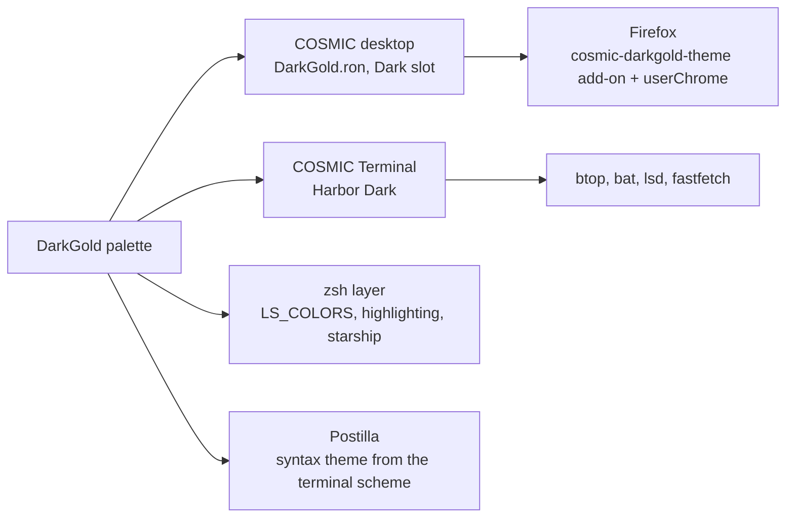

# DarkGold

> Charcoal and gold, the reference rice.

Pop!_OS 24.04 on the COSMIC desktop, one palette carried through the whole
machine: desktop, terminal, shell, editor, browser. This note is the rice
describing itself, written in Markdown and rendered by **Postilla**.

## Palette

Every text colour is checked against the window background `#1B1B1B`.

| Role | Hex | Contrast on background |
|------|-----|------------------------|
| Text | `#EFEBDC` | 14.4:1 |
| Gold, accent | `#C0AF7F` | 7.9:1 |
| Brass, success | `#A99B7A` | 6.3:1 |
| Coral, headers | `#E75A50` | 4.9:1 |
| Salmon | `#E58980` | 6.7:1 |
| Error | `#F44336` | 4.7:1 |
| Slate | `#77838A` | 4.4:1 |

Containers sit one step away from the background at `#2A2A29`, which is
what frosted glass blurs into.

## Where the colours go



## Setup, in order

- [x] Import `cosmic/DarkGold.ron` into Appearance, **Dark** slot
- [x] Import `cosmic-term/DarkGold-term.ron`, pick **Harbor Dark** for the profile
- [x] `./cosmic/install.sh` for fonts, **Kanagawa** icons and the terminal look
- [x] `./zsh/install.sh`, `./lsd/install.sh`, `./fastfetch/install.sh`
- [x] Cursor: Oxygen-05-Vibrant-Red
- [x] Wallpaper: `cool-wallpapers/cosmic/darkgold/darkgold-reaper-skull`
- [x] Screenshot for the README

## The baseline every rice shares

```ron
corner_radii: (
    radius_xs: (2.0, 2.0, 2.0, 2.0),   // squared corners
    radius_xl: (2.0, 2.0, 2.0, 2.0),
),
frosted: VeryLow,
frosted_windows: true,
frosted_panel: true,
frosted_applets: true,
frosted_maximized_apps: false,
gaps: (0, 7),
active_hint: 1,
```

Contrast is the WCAG ratio[^1], where $L$ is relative luminance:

```typst
$ (L_1 + 0.05) / (L_2 + 0.05) >= 4.5 $
```

---

*Rendered in Postilla, a Markdown notes app for COSMIC. The window is painted
with this rice's terminal scheme, imported as a syntax theme.*

[^1]: Web Content Accessibility Guidelines, success criterion 1.4.3. Normal text wants 4.5:1, large text 3:1.
